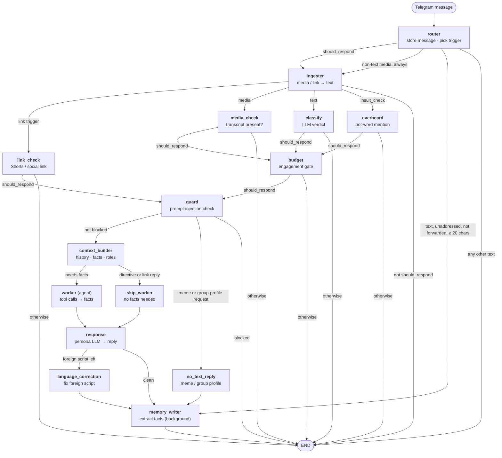
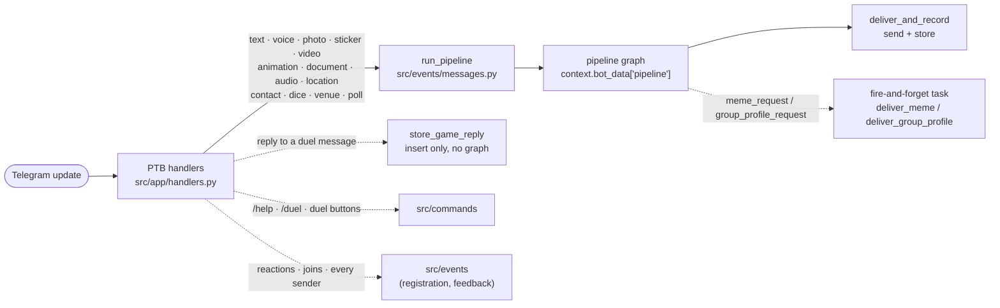
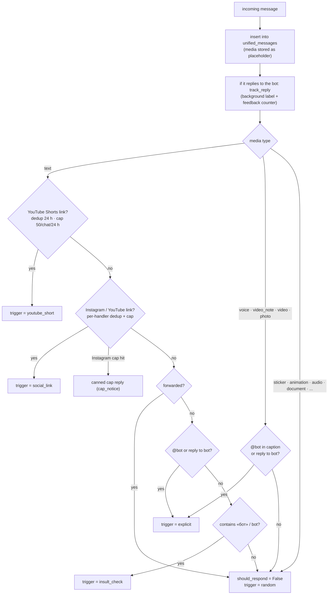
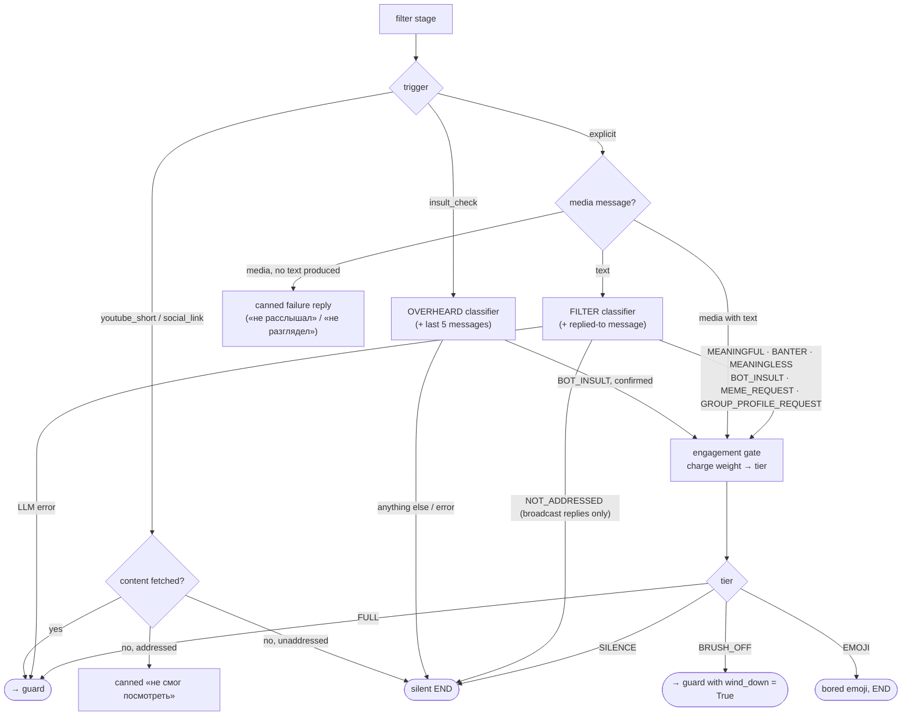
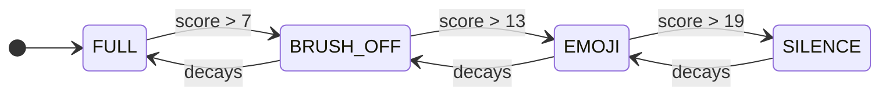
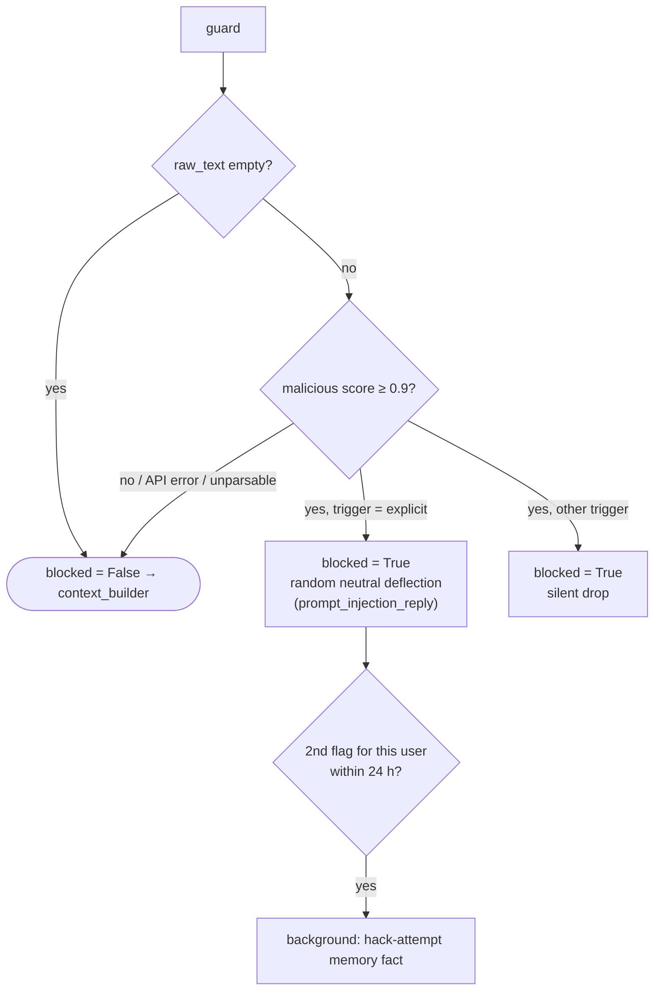
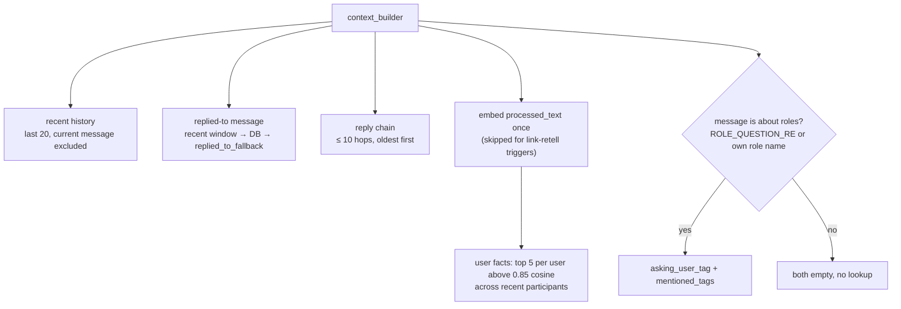
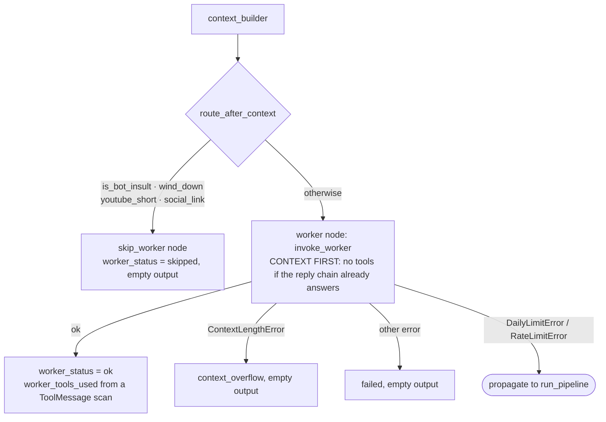
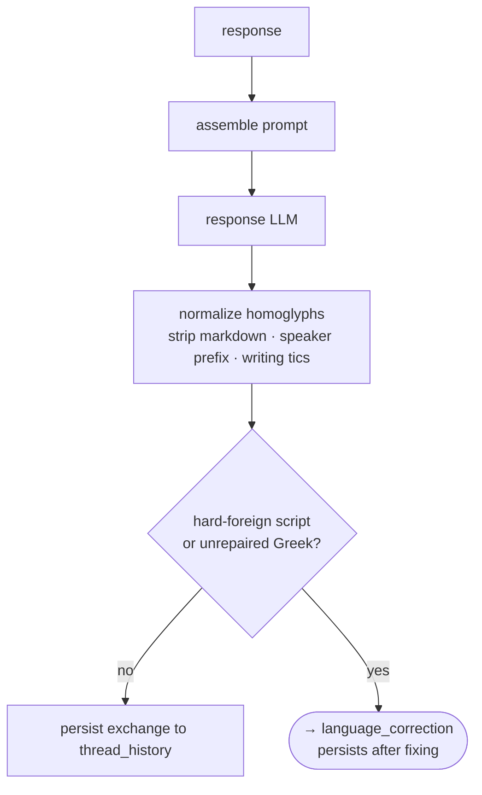
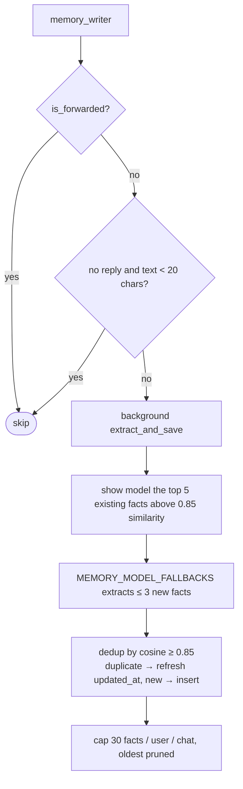

# Pipeline

A LangGraph `StateGraph` that every group-chat message passes through. Each node reads
`BotState` and returns a partial update dict; the edges are plain Python routing functions
in `graph.py`. The graph decides **whether** the bot answers and, if so, builds the answer.

The diagrams are [Mermaid](https://mermaid.js.org/) and render on GitHub and in most IDEs.

---

## 1. The whole graph at a glance

Things the arrows do not show:

- **`END` is not always silence.** A node can end the run *and* leave a canned `response`
  (guard deflection, media_check's «не расслышал…», router's Instagram-cap reply) or fire an emoji
  reaction. `run_pipeline` (`src/events/messages.py`) delivers whatever `response` the final
  state holds.
- **Unaddressed media still costs work.** `route_after_router` sends *all* non-text media to
  `ingester`, even when `should_respond` is False, so voice, video and photos are transcribed
  or described and the stored row is enriched. The run then ends before the filter stage.
  Stickers are the exception: they are described only when the bot is about to answer.
- **Meme and group-profile requests produce no text.** The guard routes them straight to
  `no_text_reply` (no context builder, worker or response LLM), which leaves an empty reply and
  `worker_status = skipped`; the events layer then sends the meme or profile itself. The memory
  writer therefore runs without `recent_history` for these requests.
- **Not every update gets here.** See [What bypasses the graph](#2-where-the-graph-sits).

---

## 2. Where the graph sits

`PipelineManager` (`src/app/pipeline.py`) builds the two LLM agents and the compiled graph once
at startup and stores it in `app.bot_data`; handlers reach it through
`get_pipeline(context)` (`graph.py`). The agents live in `agents/` (`WorkerAgent`,
`ResponseAgent`), build their LangChain executor on construction, and sit on top of the
shared LLM-call code in `src/llm`, never the reverse. The response agent is shared by the
`response` and `language_correction` nodes.

Scheduled jobs (`src/jobs`) and the meme/group-profile tasks run outside the graph.

---

## 3. Router

Stores every message, checks for links, and decides the **trigger**.

| Trigger | `should_respond` | Meaning |
|---|---|---|
| `youtube_short` | True | Shorts link: summarized and re-posted as a video with caption. Checked first, even for forwarded messages (forwarding is how links usually arrive). |
| `social_link` | True | Instagram Reel / YouTube video link. First matching handler wins; other links in the message are ignored. Only Instagram has a daily cap (30/chat/24 h). |
| `explicit` | True | `@bot_username` (word-boundary regex, URLs and longer words don't count) or a reply to a bot message. |
| `insult_check` | True | Text contains «бот»/"bot" without addressing the bot; the filter decides whether it is really an insult. |
| `random` | False | Everything else, and every forwarded message. The run never reaches the filter stage with this trigger. |

Details worth knowing:

- A reply to the bot's link-repost message is the one reply that is **not** automatically
  `explicit`: it needs a mention or a genuine question/request.
- A reply to a group-wide announcement (`is_broadcast` row) routes as `explicit` but sets
  `broadcast_reply=True`, so the filter may judge whether the author addressed the bot at
  all. An `@mention` clears the flag.
- Only text, voice, video_note, video and photo can be `explicit`. Stickers, animations and
  audio never trigger a reply.
- `route_after_router`: text with `should_respond=False`, not forwarded and ≥ 20 characters
  goes straight to `memory_writer` (passive memory). The router itself no longer extracts facts.

---

## 4. Ingester

Turns the current message into text (`processed_text`). Runs for all non-text media and for
every addressed message.

The node lives in `src/pipeline/ingest/node.py`: one strategy function per media type
(`INGEST_STRATEGIES`), each returning an `IngestResult`. The work they call is split by what it
does:

| Module | Holds |
|---|---|
| `transcription.py` | Groq Whisper calls and the garbage / low-confidence transcript checks. |
| `vision.py` | Photo descriptions and the `[ЧЕЛОВЕК]`/`[МЕМ]` tag parsing. |
| `video.py` | Keyframe extraction (PyAV), frame descriptions, `transcribe_video`. |
| `stickers.py` | Sticker descriptions, cached per `file_unique_id`. |
| `links.py` | Shorts and social-link summaries. |
| `enrichment.py` | `enrich_media_row`, the lazy enrichment of stored placeholder rows. |

| Media / trigger | What happens |
|---|---|
| text | `processed_text = raw_text`. |
| text, `youtube_short` | Download via the `download-service` sidecar (≤ 180 s, ≤ 25 MB), Whisper transcript + frame descriptions + a short summary of the top-10 comments (`comment_summary`, one `TAG_MODEL` call). Success flag: `youtube_short_content` (None = no transcript and no frames). |
| text, `social_link` | Metadata-only fetch through the matched handler (title/caption + comment summary, no transcript or vision). Instagram also keeps the Reel's bytes in `social_link_video`. |
| voice | Groq Whisper → transcript. |
| video_note, video | Whisper + frame extraction, frames described by the vision LLM. |
| photo | Vision description, combined with the caption as `<description>\n(подпись: <caption>)`. |
| sticker | Vision description, **only when `should_respond`** (otherwise enriched lazily). |
| everything else | `processed_text = raw_text or ""`. |

After a non-text message is processed the stored `unified_messages` row is updated with the
result. Link material is **not** written to the stored row (it would resurface as history in
the next link's prompt); it is persisted on the bot's own reply row (`link_material`) instead.

**Real person vs meme.** Every vision call is told to prefix a `[ЧЕЛОВЕК]`/`[МЕМ]` tag; it is
parsed off and never stored. Photos use it directly; video frames are majority-voted
(`aggregate_real_person`). The result is `media_is_real_person` (None on any failure). Nothing
reads it any more (see [Legacy paths](#legacy-paths-no-longer-reachable)), so today the value is
computed but unused.

**Whisper.** Language pinned to Russian, `temperature=0`. A transcript is discarded when every
segment has no-speech probability > 0.6, avg_logprob < −1.0 or compression_ratio > 2.4, or when
a short transcript is known silence boilerplate. A transcript that survives but has mean
avg_logprob < −0.7 is passed on with `voice_low_confidence=True`.

**Frames (PyAV).** < 15 s → 1 keyframe at 50 %; 15–120 s → 3 keyframes (25/50/75 %);
> 120 s → audio only. Without frames the transcript is labelled as a possibly music/off-screen
audio track so lyrics are not read as the sender's words.

**Vision LLM.** All vision calls go through `src.llm.vision.make_vision_llm` (Groq primary with
an OpenRouter fallback; Groq-only without `OPENROUTER_API_KEY`).

**Lazy enrichment** (`ingest.enrichment.enrich_media_row`). The filter (replied-to row) and
`context_builder` (every photo/sticker in the reply chain) enrich placeholder rows on demand
and cache the result in `unified_messages`; stickers are also cached by `file_unique_id` in
`sticker_descriptions`, so a re-sent sticker costs zero vision calls. Animated `.tgs` stickers
stay `[sticker]`.

---

## 5. Filter stage and engagement gate

The filter stage is four graph nodes in `src/pipeline/filter/`, added to the graph by
`add_filter_stage` in `graph.py`. It runs only when `should_respond` is True. The first branch is
`route_after_ingester`, an edge, not code inside a node:

| Node | File | Job |
|---|---|---|
| `link_check` | `filter/link_check.py` | Shorts / social link: pass the summary on, or a canned failure reply if addressed, silence if not. Skips `budget`. |
| `media_check` | `filter/media_check.py` | Non-text media: transcript present → verdict `MEANINGFUL`; none → canned «не расслышал / не разглядел». |
| `classify` | `filter/classify.py` | LLM classifier for text addressed to the bot (with the replied-to message as context). Sets `filter_verdict` or ends the run. |
| `overheard` | `filter/overheard.py` | `insult_check` trigger: a cheap classifier over the last 5 messages, then a confirmation model. Only a confirmed `BOT_INSULT` continues; everything else is dropped silently after passive fact extraction. |
| `budget` | `filter/budget.py` | Charges the engagement gate, maps verdict + tier onto reply flags, an emoji reaction or silence. |

The diagram below flattens the four nodes into one decision tree.

**Classifier verdicts**

| Verdict | Meaning | Effect at the FULL tier |
|---|---|---|
| `MEANINGFUL` | A real message. | Normal reply. |
| `MEANINGLESS` | Content-free reaction. | Friendly emoji reaction, no reply. |
| `BANTER` | Content-free jab. | Reply; sets `wind_down` so a mirrored insult never earns a fresh comeback. |
| `BOT_INSULT` | Insult aimed at the bot. | `is_bot_insult=True` (comeback hint, worker skipped). A reply to the bot's own message also sets `wind_down`. |
| `MEME_REQUEST` | «скинь мем». | `meme_request=True`: the guard routes it to `no_text_reply` (empty reply), the events layer sends a meme. |
| `GROUP_PROFILE_REQUEST` | Judge/rank every member against a user-supplied theme. | `group_profile_request=True` (unless the 10-minute per-chat cooldown applies → canned refusal). See `src/group_profile/README.md`. |
| `NOT_ADDRESSED` | Author is talking *about* the bot to the chat. | Honoured **only** when `broadcast_reply` is True; otherwise downgraded to `MEANINGFUL`. |

Deterministic floors under the classifier:

- A `MEANINGLESS`/`BANTER` verdict on text that looks like a question or request («?», more than
  `SUBSTANTIVE_WORD_COUNT` non-laughter words, leading interrogative, request verb such as
  «переведи»/«расскажи») is overridden to `MEANINGFUL`. `@handles` are stripped first.
- `GROUP_PROFILE_REQUEST` is trusted only when `GROUP_PROFILE_MARKER_RE` also matches the text.
- Replied-to photos/stickers still in placeholder form are vision-enriched before classification.
- An LLM error fails **open** (`should_respond=True`).

Models: `FILTER_MODEL` = `qwen/qwen3.8-27b` (with `FILTER_FALLBACK_MODEL` via `filter.classify.make_filter_llm`),
`INSULT_CONFIRM_MODEL` = `qwen/qwen3.8-27b`. The overheard-insult confirmation is therefore a
same-model re-ask, not an independent second opinion; disagreement or error resolves to silence.

### Engagement gate

`engagement_gate.py` + `store/engagement.py` (table `engagement_scores`): one leaky-bucket
attention score per `(chat_id, user_id)`, persisted in Postgres so a redeploy never resets a
wound-down user. Each addressed verdict charges a weight, decayed with a **60-minute half-life**
in one atomic UPSERT; the post-charge score maps to a tier.

| Verdict | Weight |
|---|---|
| `GROUP_PROFILE_REQUEST`, `BOT_INSULT` | 3.0 |
| `BANTER`, `MEANINGLESS` | 2.0 |
| `MEANINGFUL`, `MEME_REQUEST` | 1.0 |

| Tier | What the user gets |
|---|---|
| FULL | Full reply. |
| BRUSH_OFF | `should_respond=True` + `wind_down=True`: one short closing phrase, worker skipped. `MEME_REQUEST`/`GROUP_PROFILE_REQUEST` get a refusal directive instead of the feature. `BANTER` degrades to the bored emoji. |
| EMOJI | No reply; a bored emoji from `DISMISSIVE_REACTIONS` (🥱 😴 🗿 🤨). `MEANINGLESS` keeps the friendly `REACTION_POOL` until this tier. |
| SILENCE | Nothing at all. |

Paced conversation (one exchange per 10+ minutes) never reaches BRUSH_OFF. Store errors fail
open to FULL. The «Оскорблял бота N раз» counter fact in `user_memories` is incremented for every
addressed or double-confirmed insult at any tier; it feeds weekly roles and roasts only, and the
context builder filters counter tallies out of reply prompts.

---

## 6. Guard

`llama-prompt-guard-2-86m` (`GUARD_MODEL`), run on **typed text only** (`raw_text`: message text or
media caption). Transcripts and vision descriptions are never scanned — they are our own models'
output.

The model returns a probability-of-malicious string (`«0.9996»` for an injection), not labels;
`GUARD_SCORE_THRESHOLD = 0.9`. The deflection presumes no guilt, since false positives are
inherent at 86M parameters. API errors fail open.

---

## 7. Context builder

Assembles `AssembledContext` for the prompt.

- **Relevance is decided by retrieval, before the prompt exists.** Injecting every stored fact
  and asking the model to ignore the irrelevant ones produced absurd replies. Pure similarity,
  so a fact learned minutes ago is not recalled unless the message is about it. Counter tallies
  have NULL embeddings and never match.
- **Roles are gated the same way.** Before the gate, the asker's role loaded whenever they merely
  had one and thread history made it self-sustaining.
- Link-retell triggers skip the embedding: their `processed_text` is a fetched material block,
  so the vector would describe a video rather than anything a member said.
- Photo and sticker rows in the reply chain are lazily vision-enriched.

---

## 8. Worker (agent)

The only real agent in the graph: `create_agent` with 11 tools (games, IGDB/Steam/PS Store,
movies/TV, anime, web search). Model chain `WORKER_MODEL_FALLBACKS`:
`openai/gpt-oss-120b` → `qwen/qwen3.8-27b` → `openai/gpt-oss-20b`. There is deliberately no 8B
floor, because at that size the worker fabricates from memory instead of calling tools.

- `SearchNotificationCallback` sends «🔍 Ищу…» before a web search; the failure notice later edits
  that message in place.
- `worker_status` is recorded in `bot_message_content` (`src/message_content/README.md`).

---

## 9. Response (persona LLM)

`ResponseAgent`: `create_agent` with no tools, so effectively a plain model call with
retry/fallback middleware. Chain: `openai/gpt-oss-120b`, then the OpenRouter fallbacks (skipped
without `OPENROUTER_API_KEY`).

Code layout: `response_node.py` is the node (history, the LLM call, the trace);
`response_prompt.py` holds the pure prompt-assembly functions (also used by `worker_node` and
`context_builder`); `reply_text.py` cleans the model's reply (markdown, leaked speaker labels,
writing tics).

**Prompt assembly (in order of authority)**

| Block | Rule |
|---|---|
| Thread history | Last 10 turns, scoped to `{chat_id}_{root_message_id}`, reply chains only. Flat mentions skip it and are stored under the prospective root so a follow-up chain starts pre-seeded. |
| Recent history | Last 10 rows. Dropped entirely when thread history is present. Link-retell triggers get none. |
| Replied-to | Always rendered, except when that exact message was already printed in recent history. |
| User facts, roles | From `context_builder`. |
| Worker findings | Framed by provenance: «проверено через инструменты» if a tool ran, «из контекста разговора (НЕ проверялись)» otherwise. External-world numbers (prices, player counts, dates) are allowed only from the first frame. |
| Trigger line | Voice: the transcript is the person's own words (softened for low confidence). Photo/video: framed as a description to react to. Shorts/social links: retell framing (1–2 sentences, no verdict, no fact-checking). |

**Hints** (override the default persona): `is_bot_insult` → sharp comeback; `wind_down` → one short
closing phrase, no questions. Insult and wind-down hints forbid counter-questions.

**Safety on input.** Every rendered row is `neutralize_speaker_lines`-ed (history is a flat
`speaker: content` transcript, so a member could forge a «Ты (бот): …» turn) and capped at
`ROW_CHAR_LIMIT = 400`. The bot's own past messages render as «Ты (бот): …».

**Output.** `response_messages` is saved for `language_correction`; `response_trace` (exact
prompt, raw response, model, tokens, latency) is saved for `bot_llm_log` by `deliver_and_record`.
At DEBUG, `log_response_input` dumps the exact LLM input. Sanitization runs on both the send path
and the thread-history path, so what is stored matches what the chat saw.

`DailyLimitError`/`RateLimitError` propagate to `run_pipeline`, which sends a limit notice.

---

## 10. Language correction

Runs only when the reply still contains hard-foreign script (CJK, Hangul, Thai, Arabic, Hebrew) or
Greek fused into a Cyrillic word that homoglyph normalization could not repair.

- Re-invokes `ResponseAgent` with the original `response_messages` plus a correction instruction.
- Normalizes homoglyphs in the corrected reply, then persists the final reply to `thread_history`.
- Limit errors propagate; any other error keeps the original reply.

---

## 11. Memory writer

Always the last node. Fire-and-forget (`asyncio.create_task`), so it never delays the reply.

- **Only the user's own words are evidence.** The bot's reply is context, never a fact source;
  voice transcripts are spoken words; photo/video descriptions are marked as *not* the user's
  words (`source_kind`: `text` | `voice` | `media_description`).
- **Faithfulness over recall.** Conditionals and hypotheticals are not recorded as happened;
  sentiment is never inferred. Borderline phrasings yield no fact rather than a wrong one.
- Facts are written in Russian, expire after `FACT_RETENTION_DAYS = 14` (nightly cleanup job), and
  cross-user extraction for `@mentioned` users (message ≥ 20 chars) stores them as «по словам @X, …»
  with a sincerity rule (banter and insults are not facts).

---

## 12. BotState

Fields grouped by the node that sets them (`state.py`).

| Set by | Fields |
|---|---|
| entry (`build_pipeline_state`, `run_pipeline`) | `incoming` (`IncomingMessage`), `context_types`, `thread_id`, `is_flat_thread` |
| router | `should_respond`, `response_trigger`, `broadcast_reply`, `youtube_short_url`, `social_link_handler`, `social_link_url`, `social_link_cap_remaining`, `link_message_is_bare`; `response` + `content_kind` for the Instagram cap reply |
| ingester | `incoming.processed_text`, `media_is_real_person`, `voice_low_confidence`, `youtube_short_content`, `youtube_short_video`, `social_link_content`, `social_link_video` |
| filter stage (`link_check`, `media_check`, `classify`, `budget`) | `should_respond`, `filter_verdict`, `is_bot_insult`, `wind_down`, `meme_request`, `group_profile_request`, `engagement_tier`, `drop_reason`; `response` + `content_kind` for canned replies |
| guard | `blocked`, `drop_reason`; `response` + `content_kind = prompt_injection_reply` |
| context_builder | `context` (`AssembledContext`) |
| worker | `worker_output`, `worker_tools_used`, `worker_status`, `search_notification_msg` |
| response | `response`, `response_messages`, `response_trace` |
| language_correction | `response`, `response_trace` (updated) |

`IncomingMessage`: `update`, `chat_id`, `user_id`, `username`, `raw_text` (text or caption),
`processed_text`, `media_type`, `message_id`, `reply_to_msg_id`, `file_id`, `is_forwarded`,
`media_group_id`, `replied_to_fallback`.

`AssembledContext`:

| Field | Content |
|---|---|
| `user_facts` | username → facts relevant to *this* message (top 5 per user above 0.85 cosine, closest first). |
| `recent_history` | Flat window, last 20, newest first. |
| `replied_to` | The message being replied to; carries `link_material` for the bot's own link-repost rows. |
| `reply_chain` | Root to replied-to, oldest first. |
| `asking_user_tag` | `{tag, reason}` weekly role of the sender; None unless the message is about roles. |
| `mentioned_tags` | username → `{tag, reason}` for typed `@mentions`; empty under the same gate. |

`ContentKind` (`state.py`) records why a bot message exists: `response`, `link_summary`,
`wind_down_reply`, `insult_reply`, `prompt_injection_reply`, `limit_notice`,
`context_limit_notice`, `cap_notice`, `media_failure_notice`, `error`.
`WorkerStatus`: `ok`, `skipped`, `context_overflow`, `failed`.

---

## Models in use

| Stage | Config | Current value |
|---|---|---|
| guard | `GUARD_MODEL` | `meta-llama/llama-prompt-guard-2-86m` |
| classify / overheard confirm | `FILTER_MODEL`, `INSULT_CONFIRM_MODEL` | `qwen/qwen3.8-27b` |
| vision | `VISION_MODEL` | `qwen/qwen3.8-27b` (OpenRouter fallback via `make_vision_llm`) |
| comment summary | `TAG_MODEL` | `qwen/qwen3.8-27b` |
| transcription | `WHISPER_MODEL` | `whisper-large-v3` |
| worker | `WORKER_MODEL_FALLBACKS` | `gpt-oss-120b` → `qwen3.8-27b` → `gpt-oss-20b` |
| response | `RESPONSE_MODEL_FALLBACKS` + OpenRouter fallbacks | `gpt-oss-120b` → OpenRouter chain |
| memory extraction | `MEMORY_MODEL_FALLBACKS` | see `src/config/models.py` |

---

## Legacy paths no longer reachable

The router only ever sets `should_respond=True` with `explicit`, `insult_check`, `youtube_short`
or `social_link`; both of its `random` returns are `should_respond=False` (`router.py`
`__decide`). `random` survives only as the label for "no trigger" in logs. The random-trigger
branches in the filter stage, response and worker nodes (left over from the autonomous-reaction era,
removed on 2026-08-07) have been deleted. One remnant is left:

- `media_is_real_person`: still computed by the ingest stage's vision calls (and the `[ЧЕЛОВЕК]`/`[МЕМ]`
  tag still costs prompt tokens), but nothing reads it since the meme gate was removed.
